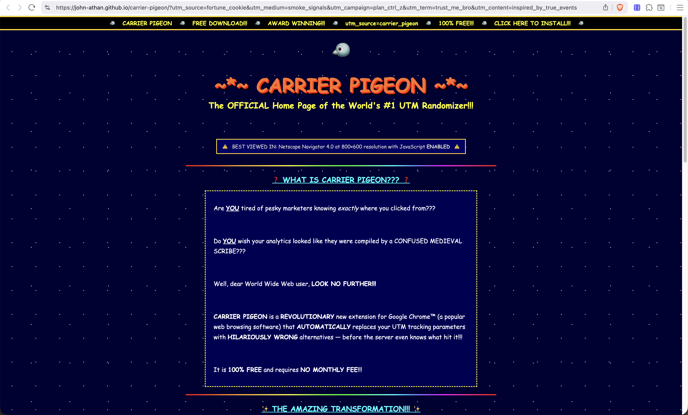
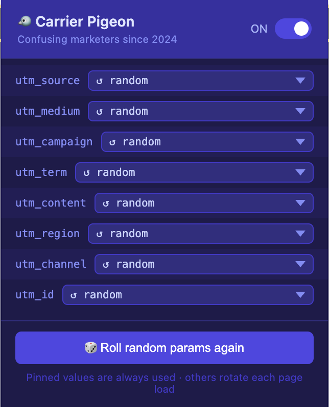

# Carrier Pigeon

**Replaces UTM tracking parameters with hilariously implausible alternatives.**

**[john-athan.github.io/carrier-pigeon](https://john-athan.github.io/carrier-pigeon)**



Marketers tag links with `utm_source`, `utm_medium` and friends to learn where you came
from. The message was meant for them. Carrier Pigeon intercepts it in transit and
substitutes a different one, so the dashboard receives a report of the traffic it
deserves.

## What it does

Before the request leaves the browser, each of the eight parameters below that is present on a page or frame
navigation is replaced with a value picked from a list of nonsense:

```
before  https://example.com/pricing?utm_source=newsletter&utm_medium=email&utm_campaign=spring_sale
after   https://example.com/pricing?utm_source=ouija_board&utm_medium=screaming_into_void&utm_campaign=operation_hope_for_best
```

Values re-roll every minute, so two visits read as two unrelated sources. The roll
is random. The values above are three of the possible ones, not a promise.

It only replaces. A link with no UTM parameters stays a link with none, because adding
one would make this extension a tracker in its own right.

## Which parameters

`utm_source`, `utm_medium`, `utm_campaign`, `utm_term`, `utm_content`, `utm_region`,
`utm_channel` and `utm_id`. The popup lets you pin any of them to one value instead
of rolling it, for example `utm_source` to `carrier_pigeon`, and has a switch to turn
the whole thing off.

## Permissions and privacy

| Permission | Why |
|---|---|
| `declarativeNetRequest` | Rewrites the query string inside the browser, so no extension code reads the page |
| `*://*/*` host access | A redirect rule can only act on sites it has access to, and a UTM link can point anywhere |
| `alarms` | The one-minute clock that re-rolls the values |
| `storage` | Remembers the on/off switch and your pinned values, locally |

No network requests of its own, no analytics, no account. It does not read, log or
send the pages you visit. See [docs/privacy-policy.html](docs/privacy-policy.html).

## Install

From the [Chrome Web Store](https://chromewebstore.google.com/detail/carrier-pigeon/dblffmdgkefdgboeodpfdcnkcnimojcl).
Or from source:

1. `git clone https://github.com/john-athan/carrier-pigeon.git`
2. Open `chrome://extensions` and switch on Developer mode
3. **Load unpacked**, and choose the `src/` folder



## Development

```sh
tools/validate.sh    # every check CI runs
```

The values and the rule are in `src/utm-data.js`, shared by the service worker and the
popup. See [CHANGELOG.md](CHANGELOG.md) for what changed.

## License

MIT. See [LICENSE](LICENSE).
